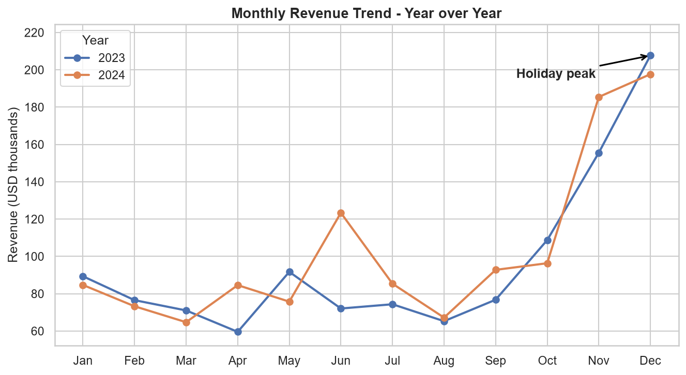
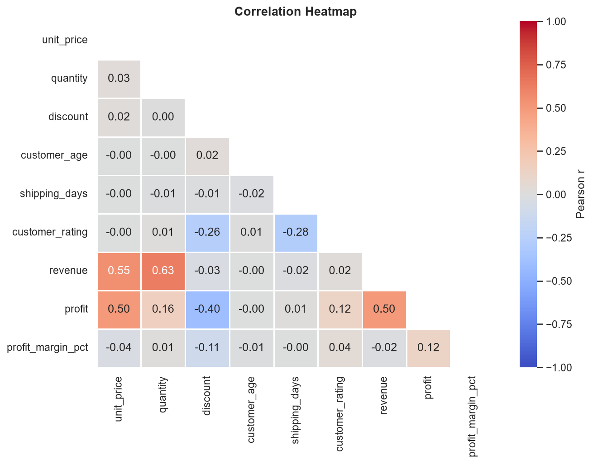
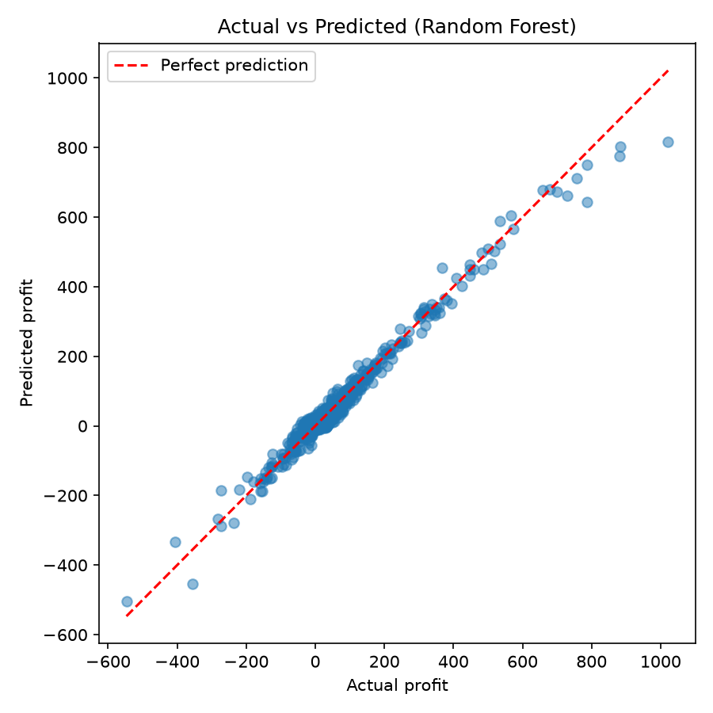

# Retail Sales EDA with Python

Exploratory data analysis of 5,000 retail orders (2023-2024) using **Python, Pandas, NumPy, Matplotlib and Seaborn**.

## Objectives
- Import a CSV dataset with Pandas
- Clean data: missing values, duplicates, invalid entries, outliers
- Transform and filter data, and create new features
- Calculate descriptive statistics and find trends
- Analyze relationships between variables
- Build 7 professional visualizations
- Draw data-backed conclusions

## Project Structure
```
generate_data.py     # creates the raw dataset
eda_project.py       # full analysis pipeline
requirements.txt     # libraries needed
insights.txt         # auto-generated key findings
data/                # raw and cleaned CSV files
figures/             # exported charts
```

## How to Run
```
pip install -r requirements.txt
python generate_data.py
python eda_project.py
```

## Methodology
1. **Import:** loaded the CSV and audited missing values and duplicates.
2. **Clean:** removed 120 duplicate rows, fixed text casing and whitespace, converted dates, replaced impossible ages with missing values, filled gaps with the median (numbers) or mode (categories), and flagged 45 bulk-order outliers with the IQR rule.
3. **Transform:** created revenue, profit margin, month, age group and discount band columns.
4. **Analyze:** descriptive statistics, skewness, and group summaries by category, region and discount level.
5. **Visualize:** bar, line, histogram, pie, scatter, box plots and a correlation heatmap.

## Visualizations
| Chart | Purpose |
|---|---|
| Bar | Revenue and profit by category |
| Line | Monthly revenue trend by year |
| Histogram | Age and order value distributions |
| Pie | Category share and payment methods |
| Scatter | Revenue vs profit, shipping vs rating |
| Box plot | Profit by discount level, rating by region |
| Heatmap | Correlations between variables |




## Key Findings
- Technology generates about **69% of revenue**, but Office Supplies has the best margin (**~21%**). Furniture is the weakest (**~4%**).
- Revenue is strongly seasonal: **November-December bring ~31% of revenue**, peaking in December.
- Deep discounts (20-30%) lose money: about **-$44 profit per order**, versus **+$81** with no discount.
- Slower shipping lowers ratings (correlation **-0.28**). The **South region ships ~2 days slower** and has the lowest average rating.
- Order value is highly right-skewed, so the **median (~$160)** describes a typical order better than the mean (~$476).

## Recommendations
1. Limit discounts to around 10% or less.
2. Improve South region logistics.
3. Promote high-margin Office Supplies.
4. Prepare inventory and marketing for Nov-Dec.

## Limitations
- The dataset is **synthetic**, generated to mimic real retail data.
- Correlation does not prove causation.
- Median imputation can understate real variation.

## Predictive Model: Profit Regression
Predicted profit per order from price, quantity, discount, category, region, customer details and order month, using scikit-learn pipelines (imputation, scaling, one-hot encoding).

| Model | MAE | RMSE | R² (test) | R² (5-fold CV) |
|---|---|---|---|---|
| Baseline (mean) | 68.92 | 125.26 | 0.00 | -0.00 |
| Linear Regression | 51.00 | 92.73 | 0.45 | 0.45 |
| Random Forest | 14.41 | 20.01 | 0.97 | 0.97 |

Random Forest explains about 97% of the variance in profit, with a typical error of about $14 per order, against $69 for a naive average. Revenue and margin were excluded as features to avoid data leakage.



## Tools
Python 3 · Pandas · NumPy · Matplotlib · Seaborn · scikit-learn